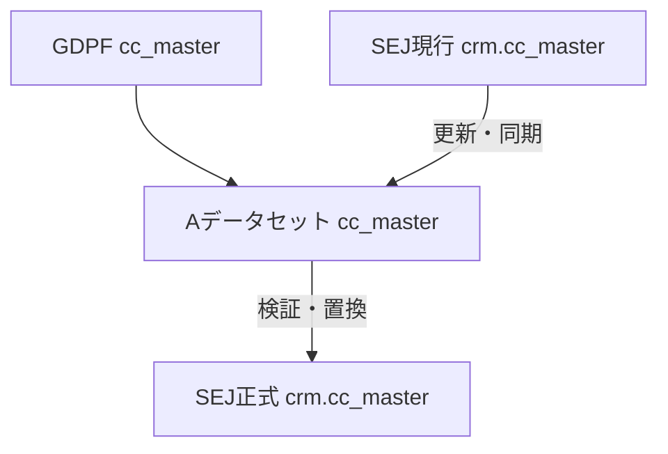
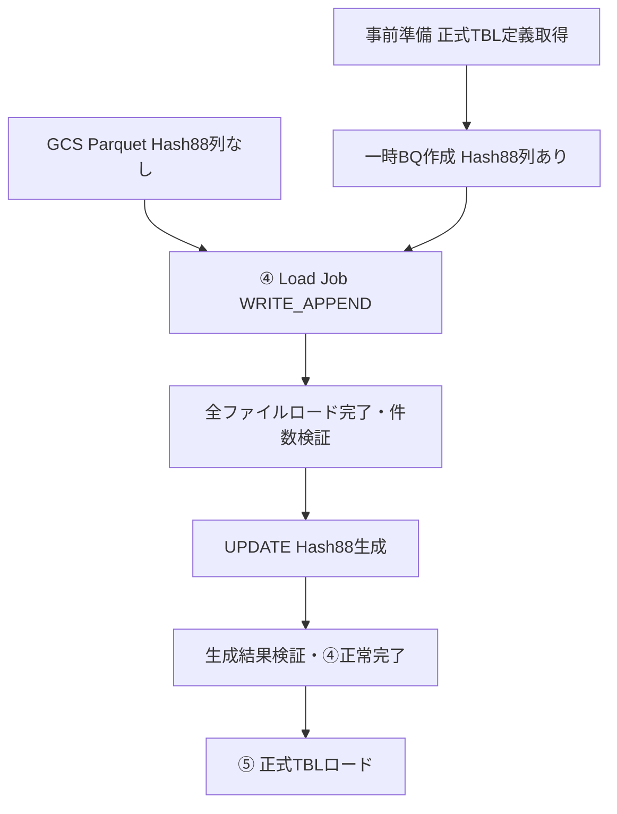

# 共通会員マスタ移行・Hash88生成方式の検討（改訂版）

**位置付け：内部レビュー用・未確定**  
**対象：事前準備、④ Parquet読み込み、⑤ 正式TBLロード**

## 1. 背景と検討範囲

GDPF側の共通会員マスタにはSEJ独自項目 `cc_id_hashed_88` が存在しない。提示資料ではGDPFのマスタをAデータセットへ移行し、SEJ現行 `crm.cc_master` を用いて更新・同期した後、現行マスタを置換する案が提示されている。

現行設計では `hash_tbl_flg = '1'` の対象表に対して、④の全ファイルロード・件数検証後にHash88を生成する想定である。今回、一時BQを正式TBL定義に基づいて事前作成し、既存のHash88列にUPDATEで値を設定する方式を追加する。

**番号について：** 本資料では④の実装方式を方式①～③とし、提示資料の現行CRM同期案は別枠の「同期・置換案」とする。旧版の番号とは異なる。今回の方式③は「事前作成＋Load＋UPDATE」である。

> 同期・置換はマスタ全体の移行方針であり、方式①～③はHash88等の加工実装である。同期の必要性と⑤の書込方式は別途決定する。

## 2. Hash88生成式

```sql
TO_BASE64(CAST(cc_id_hashed AS BYTES FORMAT 'HEX'))
```

| 段階 | データ形式 |
|---|---|
| 入力 | 128文字の16進数文字列（STRING） |
| HEXデコード | 64バイト（BYTES） |
| Base64エンコード | 88文字の標準Base64文字列（パディング込み、STRING） |

再ハッシュではなく既存ハッシュの表現形式変換である。通常のParquet Load Jobで任意のSQL関数は実行できないため、ロード後にQuery Jobとして実施する。既存ソース `resource_common_member_master_datamart.txt` は未確認であり、既存の生成仕様との一致を別途確認する。

## 3. 提示資料：現行CRM同期・置換案



Hash88のみを同期する場合の例（キーは仮定）：

```sql
UPDATE `temp.cc_master` AS T
SET cc_id_hashed_88 = S.cc_id_hashed_88
FROM `crm.cc_master` AS S
WHERE T.cc_id_hashed = S.cc_id_hashed;
```

- 現行SEJの独自項目やレコードを引き継ぐ必要があれば有効。
- GDPF側にしか存在しない会員の補完方法、同期キーの一意性、同期範囲、参照時点を確認する。
- Hash88のみが目的で、GDPF側から既存仕様と同じ値を生成できる場合は、現行CRMデータとの同期を省略できる可能性がある。
- `cc_master` の全体置換を年度別baklog等に一律適用しない。⑤の置換・追加・MERGEは表ごとに決定する。

## 4. 方式①：自動作成＋列追加＋UPDATE


```sql
ALTER TABLE `temp.cc_master_daily`
ADD COLUMN IF NOT EXISTS cc_id_hashed_88 STRING;

UPDATE `temp.cc_master_daily`
SET cc_id_hashed_88 =
    TO_BASE64(CAST(cc_id_hashed AS BYTES FORMAT 'HEX'))
WHERE TRUE;
```

- 一時表は原則1つ。Parquetのスキーマを利用可能。
- 追加列は末尾となるため、正式TBLの列順が異なる場合は揃えられない。
- 全件UPDATEの処理量・費用が発生する。複雑な項目名・型変換には不向き。

## 5. 方式②：ロード用一時表＋SELECT加工


```sql
CREATE OR REPLACE TABLE `temp.cc_master_daily` AS
SELECT
    cc_id,
    cc_id_hashed,
    TO_BASE64(CAST(cc_id_hashed AS BYTES FORMAT 'HEX'))
        AS cc_id_hashed_88,
    member_rank
FROM `temp.cc_master_daily_raw`;
```

- 項目名、型、列順、項目追加・除外等を柔軟に指定できる。
- 一時表は原則2つ。加工前データを保持可能だが、追加保存と全件SELECTの負荷が発生する。
- CTASだけでは正式TBLのNULL制約、分割・クラスタリング等まで一致するとは限らない。⑤でCOPYを使用する場合は正式TBL定義から加工用テーブルを事前作成し、明示列のINSERT SELECTを実施する方法もある。
- 再実行時は移行実行・モード専用の加工表のみ再構築するか、書込Job IDで二重INSERTを防止する。

## 6. 方式③：事前作成＋Parquet Load＋UPDATE（優先検討案）



### 6.1 事前準備

説明用の項目名・型であり、実際のDDLは正式TBL定義に従う。

```sql
CREATE TABLE IF NOT EXISTS `temp_pre1.cc_master_daily` (
    cc_id STRING,
    cc_id_hashed STRING,
    cc_id_hashed_88 STRING,
    member_rank STRING
);
```

- Hash88列はNULLABLE、デフォルト値なし（ロード直後はNULLを想定）。正式側のREQUIRED制約がある場合は別途検討する。
- 同じ列名、互換性のある型・モードを使用する。Parquetに存在しないHash88列は事前作成する。
- `CREATE TABLE IF NOT EXISTS` は既存スキーマを修正しない。既存表を再利用する場合はスキーマと実行ID・モードを検査する。
- 正式TBLを参照可能なら `CREATE TABLE ... LIKE ...` も選択肢。事前1で正式BQ参照不可の場合は事前提供の定義書からDDLを作成する。有効期限、分割、クラスタリング、必須フィルタ等も確認する。

### 6.2 Load Job

| 項目 | 設定 |
|---|---|
| source_format | PARQUET |
| create_disposition | CREATE_NEVER |
| write_disposition | WRITE_APPEND |
| schema_update_options | 原則指定なし（意図しない列追加・緩和を防止） |

```python
from google.cloud import bigquery

config = bigquery.LoadJobConfig(
    source_format=bigquery.SourceFormat.PARQUET,
    create_disposition=bigquery.CreateDisposition.CREATE_NEVER,
    write_disposition=bigquery.WriteDisposition.WRITE_APPEND,
)
job = client.load_table_from_uri(
    source_uris, destination_table,
    job_config=config, job_id=load_job_id, location=location,
)
job.result()
```

`client`、URI、テーブルID、Job ID、locationは既存処理から取得する。複数Load Jobはすべて成功してから後処理へ進む。上書きLoadは事前作成したスキーマを変更する可能性があるため使用しない。

公式資料ではParquet等のファイルに存在しない列には宛先テーブルのデフォルト値が適用される。今回のNULLABLE列ではNULLを想定する。実ファイル・対象表・実際のLoad API設定の組合せでPoCを行い、列順が途中にある場合も含めて確認する。

### 6.3 Hash88生成

```sql
UPDATE `temp_pre1.cc_master_daily`
SET cc_id_hashed_88 =
    TO_BASE64(CAST(cc_id_hashed AS BYTES FORMAT 'HEX'))
WHERE TRUE;
```

- `hash_tbl_flg = '1'` の表のみ実施。ALTER TABLE・追加加工表は不要。
- 現行CRMデータを参照せず、同一表の入力値から生成する。
- 全件UPDATEは入力値が不変なら再実行しても同じ値になる。ただしJobの実行状況を確認して不要な再実行を避ける。
- 事前1・事前2・当日・事後など、対象実行とモードの専用一時表で実施する。ロード中・⑤参照中は実行しない。
- 正式TBLにない項目、列名変更、非互換型などの別要件には、方式②を検討する。

## 7. 方式比較

| 比較項目 | 提示：同期・置換 | ① 自動作成＋ALTER＋UPDATE | ② SELECT加工 | ③ 事前作成＋UPDATE |
|---|---|---|---|---|
| 現行CRMデータ参照 | 必要 | 不要※ | 不要※ | 不要※ |
| Hash88生成式 | 同期範囲次第 | 共通式 | 共通式 | 共通式 |
| 一時表数 | 構成次第 | 原則1 | 原則2 | 原則1 |
| 事前DDL | 構成次第 | 不要 | 任意 | 必要 |
| ALTER TABLE | 実装次第 | 必要 | 不要 | 不要 |
| 列順制御 | 実装次第 | 末尾追加 | 可 | 事前DDLで可 |
| 列名変更・型変換 | 実装次第 | 個別対応 | 柔軟 | Load時の任意変換不可 |
| 原始ロードデータ保持 | 構成次第 | 加工前状態は保持しない | 可 | 加工前状態は保持しない |
| 加工コスト | JOIN・同期 | 全件UPDATE | SELECT・追加保存 | 全件UPDATE |
| 既存設計変更量 | 同期仕様次第 | 小 | 中 | 事前DDL・後処理 |
| ⑤書込方式 | 置換（提示案） | 表ごとの要件 | 表ごとの要件 | 表ごとの要件 |

※ Hash88生成だけを対象とした場合。既存仕様との一致、同期不要の確認が前提。正式テーブル定義の参照とは区別する。

方式③は一時表が1つで、列順を事前に決められるため優先検討する。ただし全件UPDATEの性能・費用が方式②より有利とは限らない。オンデマンドの非分割表UPDATEは原則 q+t（参照処理量＋更新対象表サイズ）で計算される。実データ相当のPoCで比較する。

## 8. Excel設計への反映文案

### 事前準備

> 正式BQテーブルの定義情報をもとに一時BQテーブルを事前作成する。cc_id_hashed_88生成対象テーブルについては、cc_id_hashed_88カラム（STRING、NULLABLE）を含めて作成する。カラム名、データ型、カラム順序等は正式BQテーブルの定義に合わせる。正式側と制約等が異なる場合は個別に定義する。

### ④ parquet読み込み（既存フローへの追記）

> 全Parquetファイルのロード及び件数検証が正常終了した後、hash_tbl_flg = '1' の場合は一時BQテーブルのcc_id_hashed_88生成処理を実施する。cc_id_hashedの128桁の16進数文字列をBASE64形式の88桁文字列に変換し、事前作成済みのcc_id_hashed_88カラムをUPDATEする。生成処理及び生成結果検証が正常終了した場合のみ④を正常完了とする。異常終了時はエラーログを登録し、⑤を開始しない。再実行時は完了済みのLoad Jobを重複実行せず、未完了の生成・検証処理から再開する。

### テーブル設計・チェック事項一覧

- 既存 `hash_tbl_flg` を利用。必要に応じ④内の生成・検証完了状態、BQ Job IDを管理する（既存状態管理で識別可能なら新規列は不要）。
- Hash128形式、生成後件数、Hash88文字数、変換値の一致を確認。NULL許容条件は要確認。
- ⑤は④正常完了とその他の依存条件成立後に実施する。Hash88のための追加加工は原則不要。

## 9. 検証SQL（入力NULL不可を仮定）

```sql
-- 生成前：正常条件は0件
SELECT COUNT(*) AS invalid_input_count
FROM `temp_pre1.cc_master_daily`
WHERE cc_id_hashed IS NULL
   OR NOT REGEXP_CONTAINS(cc_id_hashed, r'^[0-9a-fA-F]{128}$');
```

```sql
-- 生成後：正常条件は加工前件数と一致、異常件数0
SELECT COUNT(*) AS total_count,
       COUNTIF(cc_id_hashed_88 IS NULL
               OR LENGTH(cc_id_hashed_88) != 88) AS invalid_count,
       COUNTIF(cc_id_hashed_88 IS DISTINCT FROM
           TO_BASE64(SAFE_CAST(cc_id_hashed AS BYTES FORMAT 'HEX')))
           AS mismatch_count
FROM `temp_pre1.cc_master_daily`;
```

必要に応じて加工前後の数値項目合計も確認する。既存SEJの同一キーに対するHash88と生成値の比較は別途実施し、不一致件数のみ記録する（会員識別子をログに出力しない）。

## 10. 方式③の最小PoC（実データ不要）

前提：テスト専用Dataset `hash88_test` が存在する。GCP認証済み、`bq` とPython/PyArrowを利用可能。以下はローカルファイルをLoadする例。本番相当の確認では同じParquetをテスト用GCSに置き、URIを指定する。実際のBQ環境では未実行。

### 10.1 Parquet生成

```bash
python -m pip install pyarrow
```

```python
import pyarrow as pa
import pyarrow.parquet as pq

pq.write_table(pa.table({
    "cc_id": ["001", "002"],
    "cc_id_hashed": ["ab" * 64, "cd" * 64],
    "member_rank": ["A", "B"],
}), "hash88_test.parquet")
```

### 10.2 一時BQ事前作成（新規テスト表）

```sql
CREATE TABLE `hash88_test.cc_master_test` (
    cc_id STRING,
    cc_id_hashed STRING,
    cc_id_hashed_88 STRING,
    member_rank STRING
);
```

### 10.3 Load

```bash
bq load --source_format=PARQUET --noreplace \
  hash88_test.cc_master_test ./hash88_test.parquet
```

GCSを使う場合は末尾を `gs://YOUR_TEST_BUCKET/hash88_test.parquet` に変更する。CLI例では事前に表を作成して存在を確認する。厳密にCREATE_NEVERを指定する場合は6.2のAPIを使用する。プロジェクト・ロケーションは環境に合わせる。再試験では新規テスト表を使用するか、テスト表のみ空に戻し、重複ロードを避ける。

```sql
SELECT cc_id, LENGTH(cc_id_hashed) AS hex_len,
       cc_id_hashed_88, member_rank
FROM `hash88_test.cc_master_test`
ORDER BY cc_id;
```

期待結果：001/002の2件、hex_len=128、Hash88=NULL、rank=A/B。列名・順序・型は事前DDLのまま。

### 10.4 UPDATEと検証

```sql
UPDATE `hash88_test.cc_master_test`
SET cc_id_hashed_88 =
    TO_BASE64(CAST(cc_id_hashed AS BYTES FORMAT 'HEX'))
WHERE TRUE;

SELECT cc_id, LENGTH(cc_id_hashed) AS hex_len,
       LENGTH(cc_id_hashed_88) AS hash88_len,
       LOWER(cc_id_hashed) = TO_HEX(FROM_BASE64(cc_id_hashed_88))
           AS roundtrip_ok,
       member_rank
FROM `hash88_test.cc_master_test`
ORDER BY cc_id;
```

| cc_id | hex_len | hash88_len | roundtrip_ok | member_rank |
|---|---:|---:|---|---|
| 001 | 128 | 88 | true | A |
| 002 | 128 | 88 | true | B |

合格条件：ロード成功、2件保持、Hash88列に88文字の値、逆変換一致、他項目変更なし。さらに正式側と同等のテスト宛先にCOPYを行い、実際の分割・クラスタリング・制約の互換性を確認する。試験後はテスト用表・ファイルを削除する。

## 11. 対象テーブルと確認事項

現行設計の9表：`cc_master_daily`、`cc_master_daily_baklog_2019`～`cc_master_daily_baklog_2026`。

1. 提示資料の `cc_master` 本体も対象に含めるか。年度別表の⑤は全体置換か追加・更新かを個別確認する。
2. 既存CRMとの同期目的はHash88のみか。他項目・レコードの同期が必要か。
3. 既存ソースと変換式が同一か。入力NULL・不正値の扱いはどうするか。
4. 一時表は正式TBL定義に基づき事前作成可能か。正式側のHash88のモード、型、列位置を確認する。
5. 実Parquetと事前作成したスキーマの組合せでLoadできるか。⑤でCOPYする場合はその互換性も確認する。
6. 全件UPDATEの実行時間・処理量・費用を方式②と比較する。Job ID、状態管理、再実行単位を確定する。

**暫定結論：** Hash88だけの追加であり、事前DDLとParquetの互換性、既存仕様との一致を確認できれば方式③を優先する。複雑な項目変換は方式②を検討する。同期が必要な場合は別途同期処理を設計する。

## 12. 公式参考資料

- [Parquetデータのロード](https://cloud.google.com/bigquery/docs/loading-data-cloud-storage-parquet?hl=ja)
- [デフォルト列値（データのロード）](https://cloud.google.com/bigquery/docs/default-values?hl=ja)
- [変換関数](https://cloud.google.com/bigquery/docs/reference/standard-sql/conversion_functions?hl=ja)
- [CASTの形式要素](https://cloud.google.com/bigquery/docs/reference/standard-sql/format-elements?hl=ja)
- [DML構文・処理量](https://cloud.google.com/bigquery/docs/reference/standard-sql/dml-syntax?hl=ja)
- [テーブルスキーマ変更](https://cloud.google.com/bigquery/docs/managing-table-schemas?hl=ja)

